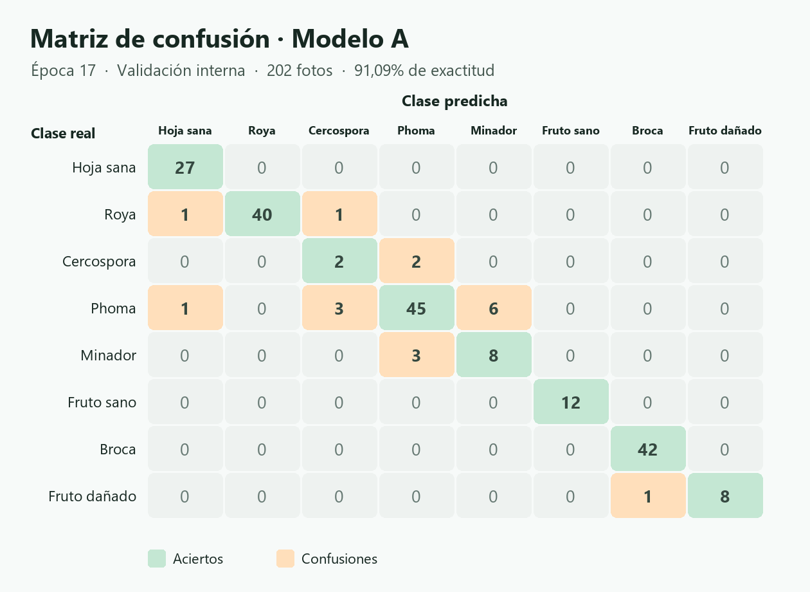

# CoffeeCare AI · Demostración y evidencia para la rúbrica

## Guion de 7 minutos

1. **0:00–1:00 · Necesidad y usuarios.** Una persona agricultora quiere fotografiar una hoja o un fruto para recibir una orientación y saber cuándo pedir revisión. Admin quiere consultar los casos inciertos y dejar una respuesta visible en el historial de Farmer. El prototipo se enfoca en café y conserva ocho clases.
2. **1:00–2:00 · Arquitectura.** Desde el celular, Streamlit valida la foto y envía los bytes y el token de sesión a FastAPI. La API verifica el token en Supabase Auth y ejecuta MobileNetV3-Small en CPU. Streamlit muestra la respuesta y, con consentimiento, guarda el registro en PostgreSQL y la foto en Storage privado. Admin accede según su rol. El modelo y la app también se pueden ejecutar en una computadora.
3. **2:00–4:00 · Recorrido.** Entra como Farmer y muestra «Tomar foto» y «Subir foto». Analiza la muestra de broca, señala la confianza y lee el siguiente paso. Usa el folio para encontrar la observación. Muestra el folio `409d68` y el comentario de Admin que solicita otra foto. Prueba un archivo de texto renombrado como `invalida.jpg` y muestra que aparece un error sin guardar otra observación.
4. **4:00–6:00 · Entrenamiento y evaluación.** Explica la separación de entrenamiento, validación, calibración y prueba. Compara A, B y el control reforzado en la misma validación. Muestra la matriz y explica los errores Cercospora–Phoma y Phoma–Minador. Separa exactitud general, exactitud selectiva y cobertura.
5. **6:00–7:00 · Despliegue y límites.** La API carga un único checkpoint calibrado. Menciona el arranque en frío de Render, el consentimiento de almacenamiento y las limitaciones por clases con pocas muestras, condiciones de captura y procedencia geográfica.

## Ingeniería de software

| Criterio | Evidencia |
| --- | --- |
| Requisitos y diseño · 10 | Historias Farmer y Admin, flujo de sesión, validación y almacenamiento descritos en el guion. Streamlit y FastAPI sirven el modelo en CPU. |
| Frontend · 15 | Captura y carga visibles al inicio del flujo, ayuda de iluminación y encuadre, tarjeta de confianza y siguiente paso, historial con estados y controles adaptados a pantallas estrechas. |
| Backend · 10 | `GET /health`, `POST /predict`, verificación de token, límites de tamaño y resolución, validación de formato y abstención bajo el umbral. |
| Integración · 10 | El folio publicado `409d68` documenta la revisión Farmer–Admin. La lista de comprobaciones de abajo registra la evidencia adicional necesaria para esta versión. |
| Calidad y documentación · 5 | Estructura y arranque en el README, SQL inicial para un proyecto nuevo y pruebas HTTP reproducibles con Auth simulado. |

## Deep Learning

| Criterio | Evidencia |
| --- | --- |
| Dataset y preprocesamiento · 10 | BRACOL, selección auditada de Project-AgML y fuentes de frutos. Se verificaron duplicados y familias antes de dividir los datos. El entrenamiento usa lotes balanceados de cuatro ejemplos por clase. La inferencia redimensiona a 224 × 224 y normaliza con los parámetros del checkpoint. |
| Modelo · 15 | MobileNetV3-Small con pesos iniciales de ImageNet, elegido para inferencia en CPU. El cuaderno documenta la preparación, el entrenamiento y la evaluación. |
| Experimentos · 10 | Control reforzado, modelo A con Focal Loss y modelo B con capa de 512 neuronas. Se probaron datos adicionales, EMA y tasas separadas. A se seleccionó por exactitud en validación. |
| Evaluación · 10 | Resultados comparables, precisión, sensibilidad, F1 y matriz de validación abajo. La prueba interna reservada mide por separado el rendimiento del A elegido. |
| Despliegue · 5 | Checkpoint PyTorch calibrado, inferencia mediante FastAPI y pruebas con fotos auditadas. La evaluación interna reservada aporta evidencia sobre imágenes que no se usaron para ajustar el modelo ni el umbral. |

[Cuaderno de entrenamiento](https://colab.research.google.com/drive/1Sz5M7k-PVridMZEGIxG9eCvAIcwcyUW6) · [Comparación A/B](https://drive.google.com/file/d/1DJiA5GNXDGugX144IsynybZ2GTYfFEuF/view) · [Métricas de prueba reservada](https://drive.google.com/drive/folders/1FLFtL777bV7-6leB2OZk7sWA211-3DSU)

### Validación interna, 202 fotos

| Configuración | Exactitud | F1 macro |
| --- | ---: | ---: |
| Control reforzado | 88,12 % | 83,16 % |
| A con Focal Loss | **91,09 %** | 84,58 % |
| B con capa de 512 neuronas | 90,10 % | **85,52 %** |

El modelo A acertó 184 de 202. Las métricas por clase se calcularon a partir de la matriz de validación original.

| Clase | Fotos | Precisión | Sensibilidad | F1 |
| --- | ---: | ---: | ---: | ---: |
| Hoja sana | 27 | 93,10 % | 100,00 % | 96,43 % |
| Roya | 42 | 100,00 % | 95,24 % | 97,56 % |
| Cercospora | 4 | 33,33 % | 50,00 % | 40,00 % |
| Phoma | 55 | 90,00 % | 81,82 % | 85,71 % |
| Minador | 11 | 57,14 % | 72,73 % | 64,00 % |
| Fruto sano | 12 | 100,00 % | 100,00 % | 100,00 % |
| Broca | 42 | 97,67 % | 100,00 % | 98,82 % |
| Fruto dañado | 9 | 100,00 % | 88,89 % | 94,12 % |
| Promedio macro | 202 en total | 83,91 % | 86,08 % | 84,58 % |

Dos de cuatro casos de Cercospora se predijeron como Phoma. Seis casos de Phoma se predijeron como Minador y tres de Minador como Phoma. El tamaño de las clases minoritarias limita la interpretación.

### Prueba interna reservada y uso en Puerto Rico

El A obtuvo **174/199 (87,44 %)** de exactitud y **79,32 %** de F1 macro en la prueba reservada. Con el umbral de **61,03 %**, clasificó **180/199 (90,45 % de cobertura)** y acertó **163/180 (90,56 % de exactitud selectiva)**. Acertó 1 de 4 casos de Cercospora en ese conjunto.

El dominio de café y la presencia de roya, broca y minador motivan el uso como prototipo para Puerto Rico. La procedencia de las imágenes y sus condiciones de captura limitan la transferencia. Todavía falta un conjunto externo etiquetado de fincas puertorriqueñas. El modelo puede asignar confianza alta a condiciones fuera de las ocho clases o a infecciones mixtas. Para explorar generalización, captura fotos nuevas con permiso de uso y registra dispositivo, luz, encuadre, clase revisada y si el modelo se abstuvo. Mantén cada finca o sesión fuera de entrenamiento si sus fotos se usarán para evaluar.

### Comprobación local y sensibilidad a la captura

En una prueba en memoria, la API con el modelo real devolvió broca con 97,40 % y resultado incierto con 47,87 % en dos fotos auditadas. Rechazó la imagen dañada con HTTP 422. En Streamlit, con una sesión Farmer simulada, el archivo dañado mostró un error, conservó el acceso al historial y no generó un guardado.

Al oscurecer artificialmente la foto de broca a 45 % del brillo original, el modelo se abstuvo con una confianza de 53,25 %. Al aplicar desenfoque gaussiano de radio 4 a la foto inicialmente incierta, el modelo aceptó la clase hoja sana con 87,44 %. Se probó también compresión JPEG a calidad 20 y ambas fotos mantuvieron su resultado original. Son dos ejemplos de sensibilidad a la calidad de imagen. La generalización a celulares y fincas de Puerto Rico requiere fotos nuevas con etiquetas verificadas.

## Comprobaciones en producción

| Caso | Evidencia que se debe guardar |
| --- | --- |
| Cámara en un celular real | Navegador y dispositivo, permiso de cámara, vista previa y folio guardado. |
| Predicción aceptada | Clase, confianza igual o superior a 61,03 %, orientación y folio en historial. |
| Archivo inválido | Mensaje al cargar un archivo dañado con extensión permitida y ausencia de un folio nuevo. |
| Regresión de revisión | Un caso incierto aparece en la bandeja Admin y el comentario se muestra en Farmer. En la versión anterior se verificó con el folio `409d68`. |

[App](https://coffeecare-ai.streamlit.app/) · [Salud de la API](https://coffeecare-api.onrender.com/health) · [Repositorio](https://github.com/lariza-amoros/coffeecare-ai)
