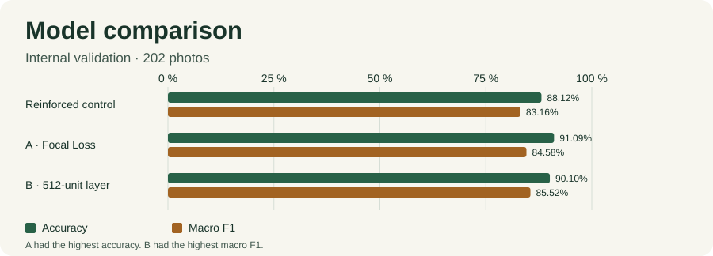
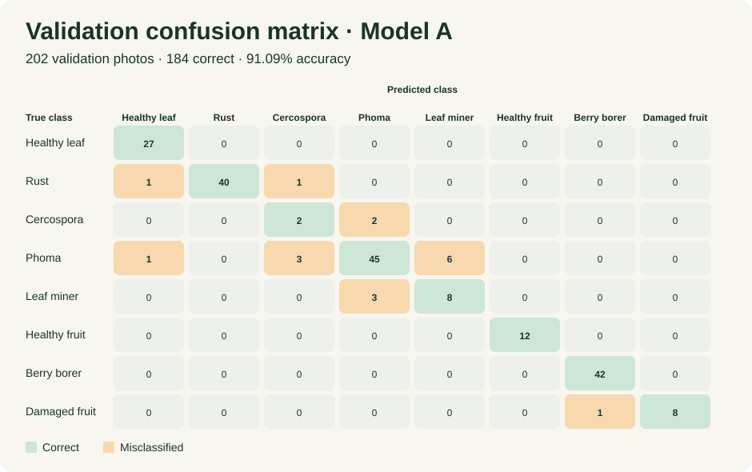
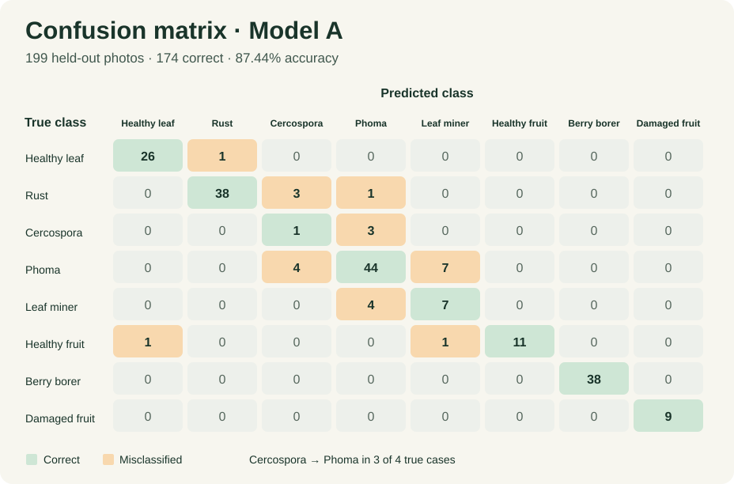
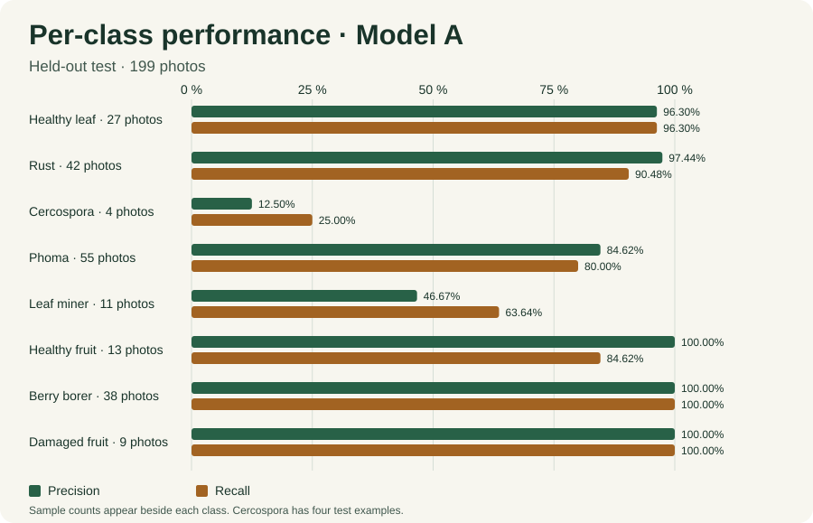

# CoffeeCare AI demonstration

## Seven-minute walkthrough

1. **0:00–1:00.** Explain how Farmer captures a photo, gets guidance, and receives follow-up from Administrator.
2. **1:00–2:00.** Explain the Streamlit, FastAPI, PyTorch, and Supabase architecture. Describe authentication, private photo storage, and consent.
3. **2:00–4:00.** Select **Caficultor**, sign in, and show photo capture and upload. Analyze the berry borer example and find its observation in the history. Switch to an authorized **Administrator** account to show the review queue. Observation code `409d68` is an example of a request for another photo. Use a text file renamed to `invalid.jpg` to demonstrate input validation.
4. **4:00–6:00.** Open **Administrator → Evaluación del modelo**. Compare validation accuracy with held-out accuracy and show how coverage changes after abstention. Use the matrix to show the confusion between Cercospora and Phoma and between Phoma and leaf miner.
5. **6:00–7:00.** Explain the CPU deployment, Render startup delay after idle periods, and the limitations of transferring the results to field photos.

## Rubric evidence

| Area | Points | Evidence |
| --- | ---: | --- |
| Requirements and design | 10 | [User stories, acceptance checks, and architecture](design-and-validation.md) |
| Frontend | 15 | Mobile photo capture, uncertainty display, observation history, and role selection |
| Backend | 10 | Token validation, upload limits, prediction endpoint, and calibrated abstention |
| Integration | 10 | End-to-end Farmer–Administrator review documented in observation code `409d68` |
| Code and documentation | 5 | Setup instructions, database bootstrap, and reproducible API and sign-in tests |
| Dataset and preprocessing | 10 | [Sources, split counts, imbalance, and local relevance](design-and-validation.md#dataset-and-training-recipe) |
| Model development | 15 | MobileNetV3-Small initialized from ImageNet, with the training recipe in Colab |
| Experiments | 10 | Reinforced control, Focal Loss in A, and a 512-unit classifier in B |
| Evaluation | 10 | In-app evidence tab, validation comparison, per-class metrics, held-out baseline, and confusion matrices |
| Deployment | 5 | Calibrated CPU checkpoint, FastAPI integration, and inference on held-out images |

[Training notebook](https://colab.research.google.com/drive/1Sz5M7k-PVridMZEGIxG9eCvAIcwcyUW6) · [A/B comparison](https://drive.google.com/file/d/1DJiA5GNXDGugX144IsynybZ2GTYfFEuF/view) · [Held-out evaluation artifacts](https://drive.google.com/drive/folders/1FLFtL777bV7-6leB2OZk7sWA211-3DSU)

## Model evidence

Model A correctly classified 184 of 202 validation photos. Two of four Cercospora cases were predicted as Phoma. Six Phoma cases were predicted as leaf miner, and three leaf miner cases were predicted as Phoma.

| Class | Validation sample count | Precision | Recall | F1 |
| --- | ---: | ---: | ---: | ---: |
| Healthy leaf | 27 | 93.10% | 100.00% | 96.43% |
| Rust | 42 | 100.00% | 95.24% | 97.56% |
| Cercospora | 4 | 33.33% | 50.00% | 40.00% |
| Phoma | 55 | 90.00% | 81.82% | 85.71% |
| Leaf miner | 11 | 57.14% | 72.73% | 64.00% |
| Healthy fruit | 12 | 100.00% | 100.00% | 100.00% |
| Berry borer | 42 | 97.67% | 100.00% | 98.82% |
| Damaged fruit | 9 | 100.00% | 88.89% | 94.12% |
| Macro average | 202 total | 83.91% | 86.08% | 84.58% |

The held-out matrix uses each photo's highest-scoring class before abstention. Model A correctly classified 174 of 199 photos (87.44%). A majority-class baseline that always predicts Phoma would classify 55 of 199 correctly (27.64%). Three of four Cercospora cases were predicted as Phoma, and seven of 55 Phoma cases were predicted as leaf miner. [Download the test matrix counts](evaluation/test-confusion-matrix.csv)

| Class | Test sample count | Precision | Recall | F1 |
| --- | ---: | ---: | ---: | ---: |
| Healthy leaf | 27 | 96.30% | 96.30% | 96.30% |
| Rust | 42 | 97.44% | 90.48% | 93.83% |
| Cercospora | 4 | 12.50% | 25.00% | 16.67% |
| Phoma | 55 | 84.62% | 80.00% | 82.24% |
| Leaf miner | 11 | 46.67% | 63.64% | 53.85% |
| Healthy fruit | 13 | 100.00% | 84.62% | 91.67% |
| Berry borer | 38 | 100.00% | 100.00% | 100.00% |
| Damaged fruit | 9 | 100.00% | 100.00% | 100.00% |

## Capture and production checks

The local API identified a berry borer sample at 97.40% confidence, abstained on a second sample at 47.87%, and rejected a damaged image with HTTP 422. A simulated Farmer session showed the upload error and left history available without saving the file.

In an exploratory check, reducing the berry borer photo to 45% of its original brightness led to abstention at 53.25%. Applying a Gaussian blur with a radius of four pixels to the uncertain photo produced a healthy-leaf prediction at 87.44%. Both examples kept their original outcomes after JPEG compression at quality 20. These are two examples of capture sensitivity. Generalization to Puerto Rican farms requires new labeled photos.

| Production check | Evidence |
| --- | --- |
| Phone camera and upload | Browser, device, preview, and saved observation code |
| Accepted prediction | Class, confidence, guidance, and matching observation |
| Invalid file | Readable error and no new observation |
| Review | Administrator can review a private observation and Farmer can read the verdict |

[Production app](https://coffeecare-ai.streamlit.app/) · [API health](https://coffeecare-api.onrender.com/health)
