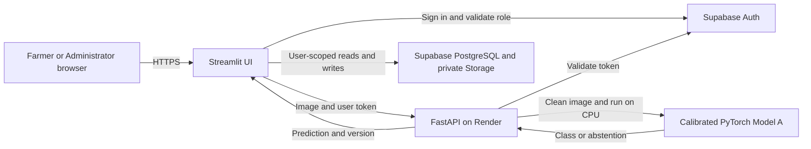

# System design and field validation

CoffeeCare serves coffee growers using a phone or computer and authorized staff reviewing observations. The application accepts images of coffee leaves and fruit for eight trained classes. Its confidence and guidance help staff and growers decide which observations to review.

| User story | Acceptance check |
| --- | --- |
| As a Farmer, I want to take or upload a coffee photo on my phone. | The capture tab offers two choices. Camera access starts when selected. A valid upload previews, and an invalid one displays a readable error. |
| As a Farmer, I want to understand the result and retrieve it later. | A consented analysis shows the predicted condition or uncertainty, model confidence, guidance, and a folio. The same folio appears in the account's history. |
| As an Administrator, I want to review a private observation. | An authorized account can find the folio, view the photo, inspect the original result, and record a review. Farmer can see the verdict for their observation. |
| As a reviewer, I want to understand the model's evidence and limits. | The evaluation tab labels the validation and test sets, compares the test to a majority-class baseline, and exposes the archived matrices and per-class metrics. |

## Architecture

The browser uses the same HTTPS app on desktop and mobile. When configured, Streamlit sends validated images to FastAPI for inference. Local development can use the checkpoint directly. Supabase policies scope data access by account and role. The deployment reuses the existing CPU service, database, and image storage.

## Dataset and training recipe

Model A combines BRACOL leaves, an audited Project-AgML leaf subset, and coffee berry images. The leaf classes and the berry-borer class address conditions relevant to coffee growers. The University of Puerto Rico Agricultural Experiment Station discusses coffee rust and berry borer in its local production guidance. The inherited labels and many isolated fruit images limit how directly the dataset represents photos of plants in Puerto Rican farms. CoffeeCare's deployed classes cover coffee. [BRACOL](https://datasetcatalog.nlm.nih.gov/dataset?q=0002931958) · [JMuBEN study](https://pmc.ncbi.nlm.nih.gov/articles/PMC8165403/) · [Project-AgML](https://huggingface.co/datasets/Project-AgML/arabica_coffee_leaf_disease_classification) · [UPR coffee production guide](https://www.uprm.edu/eea/wp-content/uploads/sites/177/2019/12/CT-cafe-Texto.pdf)

Counts come from the archived Model A checkpoint metadata. Perceptual grouping reduces overlap between near-duplicate images. The groups are heuristic and do not establish independence by plant or farm.

| Class | Train | Validation | Calibration | Test |
| --- | ---: | ---: | ---: | ---: |
| Healthy leaf | 188 | 27 | 27 | 27 |
| Rust | 212 | 42 | 43 | 42 |
| Cercospora | 39 | 4 | 4 | 4 |
| Phoma | 225 | 55 | 55 | 55 |
| Leaf miner | 107 | 11 | 11 | 11 |
| Healthy fruit | 94 | 12 | 14 | 13 |
| Berry borer | 206 | 42 | 31 | 38 |
| Damaged fruit | 57 | 9 | 14 | 9 |
| **Total** | **1128** | **202** | **199** | **199** |

Training batches sampled evenly across classes to address imbalance. The compact ImageNet-initialized MobileNetV3-Small backbone supports CPU serving. Model A uses Focal Loss with gamma 2 and head dropout of 0.2. Production converts input to RGB, resizes to 224 × 224, and uses the checkpoint's ImageNet channel normalization. Calibration selected temperature 1.25 and a threshold of 0.61026. Test results were reported separately from calibration. [Training notebook](https://colab.research.google.com/drive/1Sz5M7k-PVridMZEGIxG9eCvAIcwcyUW6) · [Experiment comparison and evaluation](demo.md#model-evidence)

## Puerto Rico smartphone validation

**Status:** Labeled field validation is pending. Internal test results and exploratory image transformations are documented separately in the [demo guide](demo.md).

1. Collect consented photos from different plants and lighting conditions, using both camera capture and gallery upload. Include varied backgrounds and, separately, blurry photos and subjects outside the eight classes.
2. Have an agricultural reviewer assign a reference class before seeing the model result. Record uncertain reference labels separately. Use one photo per plant for the primary analysis or group repeated photos by plant.
3. For the authorized evaluation team, record a study ID, private folio, device or capture mode, lighting, leaf or fruit, reference label, predicted label, confidence, model version, and abstention. Publish only aggregate results.
4. Use confirmed in-scope cases to report the confusion matrix, per-class precision and recall, macro F1, coverage, and accuracy among accepted predictions. Report unsupported-image outcomes separately. Count both false-positive and missed leaf-miner cases, and report the Cercospora sample size.
5. Separately verify that a phone capture produces a saved folio and that the same case opens in Administrator review. Record device, browser, and whether the Farmer can see the saved review.
